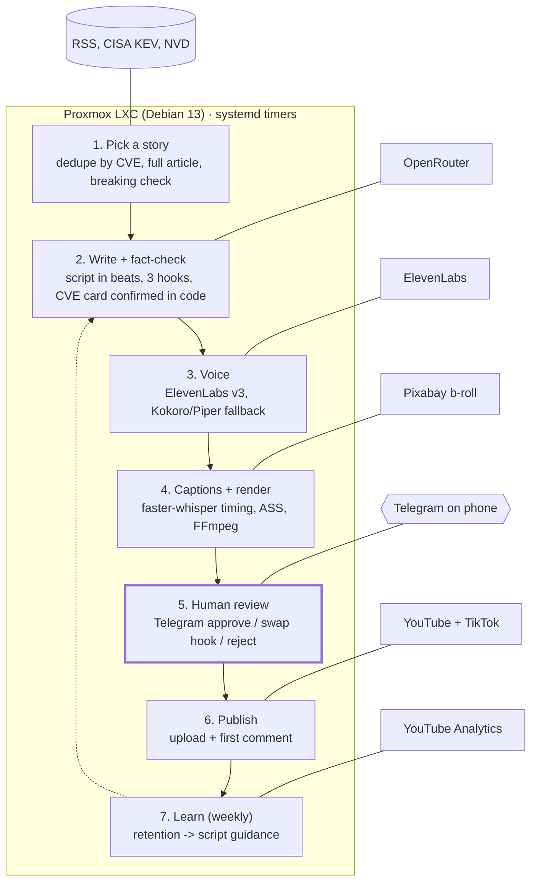

# cybershorts

Automated IT and cybersecurity news Shorts. Each run picks a recent story from RSS feeds, writes a short script, narrates it with ElevenLabs (or local Kokoro/Piper), adds word-timed captions, b-roll and music, and sends the finished 1080x1920 video to Telegram for approval. Approved videos go to YouTube Shorts and to your TikTok inbox as drafts.

## Architecture



Every job reports failures to Telegram, and a weekly job makes an encrypted backup (see "Alerts and backups").

Runs on a small Debian server with Python 3.11+, systemd timers and no paid scheduler.

## Quick start

Debian LXC, as root. The LXC needs `features: nesting=1` (Proxmox: container Options > Features) or the systemd sandboxing options (`PrivateTmp`, `ProtectSystem`) fail.

```
apt install -y python3 python3-venv ffmpeg git fonts-dejavu-core
useradd --system --create-home --shell /usr/sbin/nologin cybershorts
# put the project in /opt/cybershorts, then:
chown -R cybershorts:cybershorts /opt/cybershorts
cd /opt/cybershorts
runuser -u cybershorts -- python3 -m venv .venv
runuser -u cybershorts -- .venv/bin/pip install -r requirements.txt
runuser -u cybershorts -- cp config.example.yaml config.yaml
runuser -u cybershorts -- cp .env.example .env
chmod 600 .env                      # then fill in the keys
cp systemd/cybershorts-*.service systemd/cybershorts-*.timer /etc/systemd/system/
systemctl daemon-reload
systemctl enable --now cybershorts-bot.service cybershorts-draft.timer
```

Always run scripts as the service user, never as root. Root-owned 0600 token or db files make the service fail with permission errors:

```
runuser -u cybershorts -- /opt/cybershorts/.venv/bin/python scripts/doctor.py
runuser -u cybershorts -- /opt/cybershorts/.venv/bin/python scripts/auth_youtube.py
```

Google notes:
- The Google OAuth consent screen must be set to "In production". In "Testing" status the refresh token expires after 7 days.
- Videos uploaded through an unverified API project are forced to private until the project passes the YouTube API audit.

## Visual upgrades (v2)

- Karaoke captions: each word highlights as it is spoken (`captions.style`).
- Hook: a bold caption over the first seconds (`video.hook_seconds`).
- Branding: accent colors, a logo watermark, a progress bar and an end card (`branding`).
- Ken Burns motion on b-roll, capped at `broll.max_clips` clips (`broll.ken_burns`).
- Fact check: a second model pass checks the script against the article (`llm.fact_check`).

To add a watermark logo:

```
mkdir -p /opt/cybershorts/data/brand
cp logo.png /opt/cybershorts/data/brand/logo.png     # square PNG
chown -R cybershorts:cybershorts /opt/cybershorts/data/brand
```

Every feature can be switched off in `config.yaml`: `captions.style: plain`, `video.hook_seconds: 0`, `branding.progress_bar: false`, `branding.end_card: false`, `llm.fact_check: false`.

## v3 features

Deploy steps after pulling v3 (no new Python dependencies):

1. `csgit pull`, then `systemctl restart cybershorts-bot`.
2. Google Cloud: enable the YouTube Analytics API. Add the `youtube.force-ssl` and `yt-analytics.readonly` scopes to the OAuth consent screen.
3. Re-run `scripts/auth_youtube.py` (over an SSH tunnel) and tick every box. Then run `scripts/doctor.py`.
4. Install the timers: copy the `cybershorts-breaking` and `cybershorts-analytics` units to `/etc/systemd/system/`, run `systemctl daemon-reload`, then `systemctl enable --now cybershorts-breaking.timer cybershorts-analytics.timer`. The first breaking run only seeds the KEV list and creates no draft.
5. Optional: set `voice.engine: elevenlabs` and `voice.elevenlabs.model: eleven_v3` for audio tags (both are needed); add `NVD_API_KEY` to `.env`; tune `breaking.quiet_hours`, `breaking.daily_cap` and `series` in `config.yaml`.
6. Pin each auto-posted first comment in the YouTube app. The API cannot pin comments.
7. Learnings start once at least 6 videos are 48 hours old. Analytics lags 2-3 days.

Note: with an old `config.yaml` (one that lacks the v3 keys), every v3 feature defaults to on: breaking drafts (once the timer is enabled), first comments, NVD lookups, and the hook-pick LLM call. To turn them off, set `breaking.enabled: false`, `youtube.first_comment: false`, `data_card.nvd: false` and `llm.hooks: 1` (1 also disables alternate hooks and the hook-pick call).

## Weekly recap

Every Sunday the bot makes a 6-8 minute in-depth landscape YouTube video (a 900-1,200 word script) of the week's top stories, drawn from the Shorts published that week. It has chapters, a thumbnail and an auto first comment. You get a preview in Telegram with two buttons, "Publish to YouTube" and "Reject". It is posted to YouTube only, not TikTok, so the Shorts can send viewers to the longer video. The video and Telegram label it with the channel's own count ("Week 1", "Week 2", ...; `recap.label`).

Recaps use a "newsroom" layout by default: animated scenes (a terminal, an attack flow, a big stat, a timeline and a scam message), plus key points, a what-to-do checklist and a transition card for each story. It uses no stock b-roll. Set `recap.layout: classic` to switch back to the old b-roll style. `recap.show_title` changes the title in the top bar. To turn off parts of the newsroom layout, set `recap.newsroom.key_points` or `recap.newsroom.checklist` to false, or remove scene types from `recap.newsroom.scenes`.

Newsroom is the default from this version. After updating, run `python scripts/test_recap_newsroom.py` once on the server: it renders a 30 s sample and checks size, duration and frame count and saves review frames (needs `fonts-dejavu-core`). Set `recap.layout: classic` to go back to the old layout.

Setup, as root:

```bash
csgit pull
cp /opt/cybershorts/systemd/cybershorts-recap.* /etc/systemd/system/
systemctl daemon-reload
systemctl enable --now cybershorts-recap.timer
systemctl restart cybershorts-bot
```

Send `/recap` in Telegram to make one now (`/recap force` to remake this week's).

Notes:
- It runs Sundays at 09:30 ET and needs at least `recap.min_stories` (3) published Shorts that week.
- Each recap uses roughly 6,000-8,000 ElevenLabs credits (about one character per credit).
- Custom thumbnails need a phone-verified channel (youtube.com/verify). Without one, YouTube picks a frame and Telegram shows a warning.
- Restarting the bot while a `/recap` is rendering stops that run. The stopped run is recovered automatically: it is marked failed, and the next `/recap` or the weekly timer starts over instead of the week staying blocked.
- If a publish fails after the video is rendered, `/recap` will not remake it (that would re-spend the voice credits). Tap Publish to YouTube on it again, or send `/recap force` to remake.

## Sound kit

The sound kit is a set of ElevenLabs-generated sound effects: a hook at the start of each Short, a whoosh before beat changes, a breaking alert on breaking videos, a blip on the CVE data card, and a sting on the end card. It also includes an original theme and 3 background beds. The recap uses the theme and a bed.

Setup, as root, in `/opt/cybershorts`:

```bash
cd /opt/cybershorts
csgit pull
cs scripts/make_sound_kit.py --dry-run      # see prompts and estimated credits
cs scripts/make_sound_kit.py                # generate; each sound is sent to Telegram to listen
cs scripts/make_sound_kit.py --only hook,whoosh --variants 3   # retry ones you don't like
cs scripts/make_sound_kit.py --use hook=2   # keep variant 2
systemctl restart cybershorts-bot
```

Notes:

- Sound effects cost 40 credits per second (the whole SFX set is about 225 credits). ElevenLabs does not publish the music cost, so the estimate is about 3,500 credits for the theme and 3 beds. The script checks your balance first.
- Files live in `data/brand/sound/`. They are not in git and are included in the weekly backup.
- Generated music may be used commercially on paid ElevenLabs plans without attribution, but not resold as a library. Follow YouTube and TikTok rules for labelling AI-generated content.
- To turn it off, set `sound.enabled: false`. Videos then render exactly as before. `sound.sfx_on_tiktok: false` keeps TikTok without effects. When that clean TikTok version exists it is always what TikTok gets, even if `music.on_tiktok` is true: music is not added to it (an info line is logged). `music.prefer_kit: false` keeps your own music folder.

## Alerts and backups

**Failure alerts.** Every job (draft, breaking, analytics, backup) and the bot sends a Telegram message when it fails. The message includes the last log lines, with secrets removed, and a tip for common causes like no credits, an expired login, a full disk, or no internet. A job that keeps failing alerts at most once every `alerts.repeat_minutes` (180), and sends one "working again" note when it recovers.

**Backups.** `scripts/backup.py` saves `.env`, `config.yaml`, `client_secret.json`, the YouTube/TikTok logins, `learnings.md`, `data/brand/` and a consistent copy of the database to `data/backups/`, keeping the last 8. Videos, b-roll, music and voice models are not included. If `BACKUP_PASSPHRASE` is set in `.env`, the archive is encrypted with AES-256 and also sent to your Telegram chat as an off-site copy. Keep the passphrase in your password manager, because a backup can't be restored without it.

Setup, as root:

```bash
csgit pull
cp /opt/cybershorts/systemd/cybershorts-*.service /opt/cybershorts/systemd/cybershorts-*.timer /etc/systemd/system/
systemctl daemon-reload
systemctl enable --now cybershorts-backup.timer
systemctl restart cybershorts-bot
cs scripts/alert.py --test         # you should get a test alert in Telegram
cs scripts/backup.py               # first backup now
```

Restore on a fresh container:

```bash
openssl enc -d -aes-256-cbc -pbkdf2 -iter 600000 -in cybershorts-XXXX.tar.gz.enc -out restore.tar.gz
tar xzf restore.tar.gz             # -> cybershorts/.env, config.yaml, data/...
cp -a cybershorts/. /opt/cybershorts/ && chown -R cybershorts:cybershorts /opt/cybershorts
```

For the whole container, also schedule a Proxmox backup: Datacenter > Backup > Add, select CT 111, choose weekly, mode Snapshot, retention "keep last 4". That copy sits on the same disk as the container, so the encrypted Telegram copy is the one that survives a dead drive.

## Commands

```
python scripts/make_draft.py      # create one draft now (also run by the timer)
python scripts/recap.py --force   # make this week's recap now
python scripts/bot.py             # Telegram review bot (long-running, run by systemd)
python scripts/make_sound_kit.py --dry-run   # preview the sound kit cost
python scripts/breaking.py --dry-run      # show what a breaking run would do; no draft, no Telegram, no seen/used/urgency marks; still fetches feeds and calls the LLM
python scripts/backup.py --no-telegram   # back up now, keep it local only
python scripts/alert.py --test           # send a test failure alert
python scripts/analytics.py --no-telegram # pull stats and update learnings without the Telegram report
python scripts/doctor.py          # check config, FFmpeg, fonts, tokens and API keys
python scripts/test_render.py     # offline render smoke test (no network)
python scripts/test_recap_newsroom.py   # render a 30 s newsroom sample
python -m unittest discover -s tests -v   # unit tests (stdlib only)
```

Secrets live in `.env`. Settings live in `config.yaml` (copy from `config.example.yaml`).

## Background music

Drop licensed instrumental tracks (mp3/m4a/wav) into `/opt/cybershorts/data/music/`
(e.g. YouTube Studio → Audio library → filter "Attribution not required").
Each draft picks one at random (never the same twice in a row), mixes it quietly under
the narration and ducks it while the voice talks. The music version goes to YouTube and the
Telegram preview; TikTok gets the clean version so you can add a TikTok sound in the app
(`music.on_tiktok: true` to send the music version there too). No tracks = no music.
